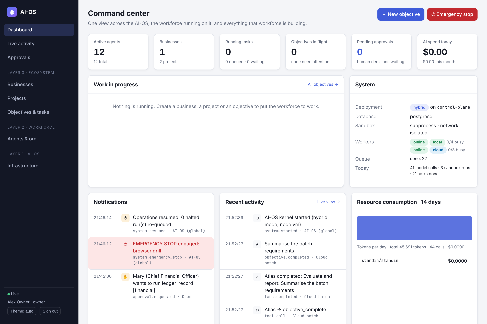

# AI-OS

An operating system for autonomous digital organizations: a modular foundation that creates, coordinates and governs
AI agents which plan work, build software, research, and run businesses — on your own hardware, in the cloud, or both.

It is built as three layers with a strict one-way dependency:

| Layer | Package | What it is |
|---|---|---|
| 1 · AI-OS | `aios_kernel` | Business-agnostic infrastructure: orchestration, durable agent runtime, model routing, memory, tools, sandbox, security, deployment. |
| 2 · AI Workforce | `aios_workforce` | Roles, departments, hierarchy, the Agent Factory, collaboration (delegate, ask, review, escalate), autonomy levels. |
| 3 · Business & Project Ecosystem | `aios_ecosystem` | Isolated businesses and projects with their own agents, workspaces, deliverables, finances, KPIs, customers, workflows. |

`aios_api` composes the three behind one HTTP API (100 operations, OpenAPI at `/api/docs`) and serves the command-center UI.

**Read [docs/ARCHITECTURE.md](docs/ARCHITECTURE.md)** for the design, the trade-offs, the security model, what has been
validated and what has not, and the roadmap.



More views: [a business](docs/screenshots/business.png) · [org chart](docs/screenshots/org-chart.png) ·
[task transcript](docs/screenshots/task-transcript.png) · [project workspace](docs/screenshots/project-workspace.png) ·
[live activity](docs/screenshots/live-activity.png) · [infrastructure](docs/screenshots/infrastructure.png).
(Captured from a run that used the stand-in model described below, so agent text in them is placeholder content.)

## Quick start (local, one process)

Requirements: Python 3.11+, Node 20+ (to build the UI once), git. On macOS: `brew install python@3.12 node`, then use
`python3.12` where the commands below say `python`. Linux gives agent code the strongest built-in isolation (no network
by default); on macOS the sandbox still confines code to the workspace with a timeout but cannot cut network access —
use the Docker sandbox driver there if that matters.

```bash
python3 -m venv .venv && .venv/bin/pip install -e ".[dev,postgres]"
```

```bash
(cd ui && npm install && npm run build)
```

```bash
.venv/bin/aios serve
```

Open http://127.0.0.1:8600 and create the owner account. State lives in `./data` (SQLite, workspaces, backups, master key).

### Connect a model

AI-OS needs at least one model. In the UI: **AI-OS → Infrastructure**.

- **Claude**: *Security → Secrets*: name `ANTHROPIC_API_KEY`, paste the key as the value, scope "AI-OS (global)",
  *Store* ([where exactly](docs/screenshots/where-to-put-api-key.png)). The `anthropic` provider and three models
  (`claude-opus-5-5` for deep work, `claude-sonnet-5-5`, `claude-haiku-5-5`) are pre-registered; the *Models* tab then
  shows the credential as "set". Keys belong only in this encrypted store — never in the repository or `.env`.
- **A local model**: run any OpenAI-compatible server (Ollama, vLLM, llama.cpp, LM Studio). *Models →* enable the
  `local` provider (or add one with your base URL) *→ Discover*. Mark it `local` so "local models only" organizations can use it.
- **Anything else with an OpenAI-compatible API**: add a provider with its base URL and the name of the secret holding its key.

Agents default to automatic routing (tier + cost/quality/latency preference, constrained by the organization's placement
policy) and can be pinned to a model individually.

### No model at hand?

`scripts/standin_model.py` is a rule-based stand-in that speaks the OpenAI protocol. It is **not** a model — its
replies are canned — but everything the "agents" do through tools is real, so you can watch planning, parallel
execution, approvals, review, sandboxed code and git history work end to end.

```bash
.venv/bin/python scripts/standin_model.py --port 8701
```

Then add an OpenAI-compatible provider with base URL `http://127.0.0.1:8701/v1`, click *Discover*, and disable the others.

## Using it

1. **Businesses → New business**: describe an idea. AI-OS creates an isolated organization, staffs it from role
   templates, sets its budget and placement, and starts the founding objective (market research, business model,
   strategy, org design) — written as real documents in the business's git-versioned workspace.
2. **Projects → New project**: requirements in, a repository with working, tested deliverables out.
3. **Dashboard → New objective**: hand any organization a goal; its lead plans a task graph, the factory adds missing
   roles, tasks run in parallel, flagged work is reviewed, and the owner evaluates the result.
4. **Approvals**: anything financial, legal or touching sensitive data — and whatever exceeds an agent's autonomy
   level — waits here for you. The agent's run is suspended, not lost.
5. **Live activity**: every agent action, message, task transition and system event as it happens.
6. **Emergency stop** (dashboard): halts all agent execution at the next checkpoint; resume continues where it stopped.

## Deployment modes

The same build runs in all three; see `deploy/` and `.env.example`.

```bash
docker compose -f deploy/docker-compose.local.yml up --build
```

```bash
docker compose -f deploy/docker-compose.cloud.yml up --build --scale worker=3
```

```bash
docker compose -f deploy/docker-compose.cloud.yml -f deploy/docker-compose.hybrid.yml up --build
```

In hybrid mode, join a machine you control to the same control plane:

```bash
AIOS_DATABASE_URL=postgresql+asyncpg://aios:<password>@<db-host>:5432/aios AIOS_SECRET_KEY=<same key> aios worker --location local
```

Where each organization's workloads run, and which models may see its data, is then a per-organization policy
(`compute` and `models`: `any | local | cloud`) set when creating a business or under *Infrastructure → Deployment*.

## Command line

| Command | Purpose |
|---|---|
| `aios serve [--no-worker]` | API + UI, with an embedded worker unless disabled |
| `aios worker --location local\|cloud` | A stateless worker against the configured database |
| `aios create-user EMAIL --role owner\|admin\|operator\|viewer` | Create an account |
| `aios backup [--include-key]` / `aios restore ARCHIVE` | Database snapshot + workspaces in one archive |
| `aios status` | Configuration, queue and audit-chain check |

## Tests

```bash
.venv/bin/python -m pytest
```

To run the same suite against PostgreSQL, point it at a server where it may create databases:

```bash
AIOS_TEST_DATABASE_URL=postgresql+asyncpg://user@127.0.0.1:5432/postgres .venv/bin/python -m pytest
```

## Layout

```
src/aios_kernel/      Layer 1   config, db, models, security/, llm/, memory/, tools/, agents/, tasks/, sandbox, budget, backup
src/aios_workforce/   Layer 2   templates, factory, collaboration, performance
src/aios_ecosystem/   Layer 3   businesses, projects, workspaces, finance, KPIs, CRM, workflows
src/aios_api/         control plane: app, one router per layer, CLI
ui/                   command center (React + TypeScript + Vite)
deploy/               Dockerfile and compose files for local, cloud, hybrid
scripts/              stand-in model for demos without an LLM
tests/                28 tests: orchestration, security, collaboration, providers, API, backup, layer boundaries
docs/ARCHITECTURE.md  the design
```
