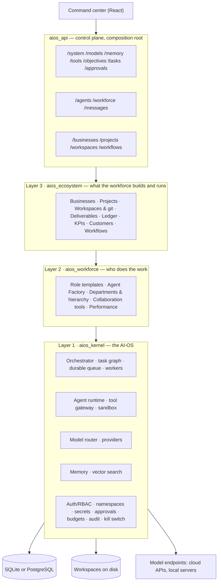

# AI-OS architecture

This document is the Phase 1 deliverable: requirements analysis, the three-layer design and its interfaces, technology
choices with their trade-offs, the data model, agent communication and orchestration, the security model, deployment in
local / cloud / hybrid form, and the roadmap. Everything described as built here exists in this repository and is covered
by the test suite unless it is explicitly marked as *not yet built*.

## 1. What the requirements demand

Reading the brief for what constrains the design, rather than as a feature list:

| Requirement | Design consequence |
|---|---|
| Three independent but connected layers; no monolith | Three Python packages with a one-way dependency rule, enforced by a test. Upper layers extend lower ones through registries and hooks, never by reaching in. |
| The AI-OS must not know about any particular business | The kernel has no "business" or "project". Its isolation primitive is an opaque **namespace** tree; Layer 3 decides that a namespace *is* a business or a project. |
| Local, cloud and hybrid from day one; no provider lock-in | No cloud SDK and no message broker in the dependency set. The queue is a database table; the database is SQLite *or* PostgreSQL through one code path; models are reached through a provider interface with a generic OpenAI-compatible adapter for anything self-hosted. Where a workload runs is data (placement policy), not code. |
| Real work, not simulated results | Agents act only through tools that do real things: write files in a git-versioned workspace, run code in a sandbox, call HTTP APIs. Completed tasks are committed; deliverables are files you can open. |
| Agents must never bypass or widen their permissions | A single gateway executes every tool call and decides from data the agent cannot write. Agents are never principals of the control API. The only agent-reachable path that creates privileges can only narrow them. |
| Human approval for consequential actions | Every tool call is classified into a category; financial, legal and sensitive-data actions pause the run for a human at every autonomy level. Runs are durable state machines, so "pause for a human" can last days and survive restarts. |
| Don't overengineer the first implementation | One process runs everything by default. Each scaling step (separate workers, PostgreSQL, remote embeddings, container sandbox) is a configuration change, and the seams for the next ones (vector index, object storage, stronger sandbox) are single interfaces. |

## 2. The three layers



### Dependency rule

`aios_api → aios_ecosystem → aios_workforce → aios_kernel`, never the reverse. `tests/test_api.py::test_layer_boundaries`
parses every import in the source tree and fails the build if a lower layer imports a higher one, or if any layer imports a
cloud-vendor SDK or a broker client.

### How an upper layer extends a lower one

The kernel exposes five extension points on the `Kernel` object. Layers 2 and 3 use only these.

| Extension point | Used by | For |
|---|---|---|
| `kernel.tools.register(Tool)` | L2, L3 | New agent capabilities (delegation, CRM, ledger…). Every registered tool automatically gets permission checks, autonomy policy, approvals, audit and events from the gateway. |
| `kernel.events.subscribe(prefix, handler)` | L3 | React to kernel facts: on `task.completed` Layer 3 commits the workspace and records deliverables; on `agent.created` it hands a new agent its business tools. |
| `kernel.orchestrator.provisioner` | L2 | The kernel asks "a plan needs role X and nobody has it"; the Agent Factory answers by creating one (or declining). |
| `kernel.job_handlers[kind]` | — | New background job kinds. |
| `kernel.extensions[name]` | L2, L3 | Each layer publishes its service object for the API layer. |

Each layer also owns its tables (`wf_*`, `eco_*`) on the shared metadata and its own API router, so a layer can evolve
without touching the others. Layer 1 runs and is tested entirely on its own (`tests/test_kernel_orchestration.py`,
`tests/test_security.py` use a kernel with no upper layers installed).

### Layer responsibilities

**Layer 1 — kernel.** Identity and RBAC; namespaces, placement and cross-namespace grants; encrypted secrets; the model
catalog, routing and fallback; memory with vector search; the tool registry and gateway; sandboxed execution; the agent
registry, lifecycle and messaging; the durable run loop; objectives, the task graph, the job queue, workers; budgets and
usage metering; approvals; the hash-chained audit log; the emergency stop; backup and restore.

**Layer 2 — workforce.** 31 role templates in 6 departments with reporting lines (data, not code — every agent is
editable afterwards and custom templates can be added at runtime); capability kits; the Agent Factory (one agent, a
department, a whole organization, or on-demand provisioning when a plan or a delegation needs a missing role);
collaboration tools (`agent_delegate`, `agent_ask`, `agent_message`, `review_request`, `escalate`, `agent_create`,
`initiative_propose`, `team_directory`); org charts; per-agent performance computed from execution records.

**Layer 3 — ecosystem.** A business = a namespace + profile + organization + budget + ledger + KPIs + customers +
workflows. A project = a child namespace + its own workspace and git repository + requirements. Creating either can
start an objective immediately. Deliverables are derived from what tasks actually committed. Workflows are reusable,
optionally recurring objectives. Sharing between businesses is expressed as kernel grants.

## 3. Technology choices and trade-offs

| Concern | Choice | Why | Cost / when to revisit |
|---|---|---|---|
| Backend | Python 3.11+, FastAPI, async SQLAlchemy 2 | The model-provider ecosystem is Python-first; agent work is I/O-bound so one event loop carries many concurrent runs. API-first: 100 documented operations at `/api/docs`. | A single event loop per process: CPU-heavy tools must stay in subprocesses (they do). |
| Database | SQLite (local) or PostgreSQL (cloud/hybrid), same code | One file with zero setup locally; a real server when there are several processes or machines. The suite passes on both. | SQLite serialises writers (`BEGIN IMMEDIATE` + WAL): fine for one machine, not for many workers. |
| Queue & workers | A `jobs` table claimed by compare-and-set; stateless `aios worker` processes | No broker to deploy, identical on both databases, transactional with the rest of the state, trivially inspectable. Affinity column gives hybrid routing for free. | Polling (1 s) instead of push; throughput bounded by the database. A broker (NATS/Redis) can replace `JobQueue` behind the same four methods when that bound is reached. |
| Agent orchestration | Own run loop and orchestrator, no agent framework | The hard requirements are *durability* (suspend for approvals/delegation/kill switch, resume on any worker) and *one enforcement point*. Both are simpler to guarantee in under a thousand lines we control than to retrofit onto a framework's loop. | We maintain it. The provider-neutral message format keeps this independent of any vendor's SDK conventions. |
| Models | Provider interface; `anthropic` (official SDK), `openai_compat` (httpx), catalog + router in the database | The OpenAI-compatible adapter covers Ollama, vLLM, llama.cpp, LM Studio and most hosted APIs, so local vs cloud is a base URL. Router ranks by tier, cost, latency and placement, with cooldown and fallback. | Model quality differences are real: a routing tier is a coarse proxy. Per-task model evaluation is on the roadmap. |
| Vector storage | Embeddings stored as float32 blobs next to their rows; cosine in NumPy; built-in hashing embedder or any OpenAI-compatible embeddings endpoint | Keeps the default install to one database and works offline. Search is one method (`MemoryService.search`). | Linear scan (capped at 20 000 candidate rows per query). pgvector or Qdrant should replace the scan for large corpora. The hashing embedder is lexical-leaning; use a real embedding model for semantic recall. |
| Real-time | Server-sent events tailing the persisted `events` table | Works across processes and machines with no extra infrastructure; the UI reads it with `fetch` so the token stays in a header. | ~1 s latency for events emitted by *other* processes (in-process events are immediate). |
| Auth | Opaque bearer tokens (SHA-256 stored), scrypt passwords, four roles | Revocable, no key management, no JWT pitfalls. | No SSO/OIDC yet; users are global, not per-business (roadmap). |
| Secrets | Fernet-encrypted rows, master key from env or a 0600 key file | Small and auditable; values are write-only through the API and never enter prompts. | Not an HSM. A Vault/KMS-backed `SecretStore` is a drop-in class. |
| Code execution | `subprocess` driver: workspace cwd, scrubbed env, rlimits, timeout, own network namespace; `docker` driver: `--network none`, read-only root, dropped capabilities | Agents need to run what they write. The subprocess driver needs nothing installed; the Docker driver is the stronger boundary. | The subprocess driver is **not** a security boundary against hostile code (it can read host files the service user can). Use the Docker driver, or a gVisor/Firecracker runtime behind the same interface, for untrusted or multi-tenant use. |
| Frontend | React + TypeScript + Vite, no component library, served as static files by the API | Small (84 kB gzipped), no build-time coupling to the backend, light and dark themes, usable from desktop to phone width. | Hand-rolled components; adopt a design system if the UI grows much beyond this. |
| Containers & deploy | One image for API, worker and CLI; compose files for local, cloud, hybrid | The same artefact everywhere; the command and environment decide the role. | The image and compose files were written but **not built in this environment** (no Docker daemon available here). |
| Monitoring | Events, audit log, usage records, worker heartbeats, `/api/health`, all in the database and UI | Enough to operate a small installation and to answer "what did the agents do and what did it cost". | No metrics/tracing export yet (OpenTelemetry is on the roadmap). |

## 4. Data model

32 tables. Naming shows ownership: unprefixed = kernel, `wf_` = workforce, `eco_` = ecosystem.

**Kernel (22).** Identity: `users`, `auth_tokens`. Isolation: `namespaces` (tree, status, `compute` and `models`
placement), `grants` (explicit, revocable cross-namespace sharing of `knowledge` / `agent` / `workflow`). Secrets:
`secrets` (ciphertext, scoped to a namespace). Models: `model_providers`, `model_catalog`, `usage_records`, `budgets`.
Agents: `agents` (role, manager, prompt, model config, tools, permissions, autonomy, execution environment, status),
`agent_messages`. Work: `objectives`, `tasks` (kind, status, dependencies, parent, attempts, result), `runs` (the full
resumable transcript and pending state), `jobs`, `workers`, `approvals`. Observability: `events`, `audit_log`
(hash-chained), `system_state` (kill switch, custom connectors). Memory: `documents`, `memory_items` (scope, embedding).

**Workforce (2).** `wf_departments`, `wf_templates` (custom role templates; built-ins live in code).

**Ecosystem (8).** `eco_businesses`, `eco_projects`, `eco_deliverables`, `eco_customers`, `eco_ledger`, `eco_kpis`,
`eco_kpi_points`, `eco_workflows`.

Schema is created with `create_all` on start. *Not yet built:* versioned migrations (Alembic) — required before the
first schema change on an installation with data.

### Namespaces: the isolation rule

A namespace can use resources in: itself, its ancestors (global and business knowledge flow down to projects), its
descendants (a business owns its projects), and namespaces that have explicitly granted it that resource kind. Sibling
businesses are invisible to each other. The same rule (`NamespaceService.visible`) governs memory search, which agents
may be assigned work, and which workflows can be run; budgets and pauses apply down the tree; secrets resolve nearest
first up the chain. A child can never have looser placement than its parent.

## 5. Agents: execution, communication, orchestration

### The run loop (`agents/runtime.py`)

A *run* is one agent working one task. Each step: check kill switch / paused namespace / agent status / cancellation →
check budgets → route to a model → call it → persist the transcript → execute the requested tool calls through the
gateway → persist again. The run ends when the model answers without calling a tool, or calls a *terminal* tool
(`plan_submit`, `review_submit`, `objective_complete`).

A run can **suspend** and later resume on any worker, because all of its state is in the `runs` row:

| Suspended because | Task status | Resumed when |
|---|---|---|
| A tool call needs human approval | `awaiting_approval` | A human approves (the call executes) or rejects (the agent gets the rejection and reason as the tool result). |
| Delegated sub-tasks are still running | `waiting` | All children are finished; their results are appended to the conversation and the agent integrates them. |
| Emergency stop, paused business/project, paused agent | `paused` | The stop or pause is lifted. Calls already executed are not repeated; calls not yet executed run once. |

Conversations are stored in a provider-neutral shape, so a run can fall back from one provider to another mid-task. For
Claude, the provider's own content blocks are kept alongside and replayed verbatim.

### The tool gateway (`tools/base.py`)

Model output is only ever a request. For each call, in order: (1) emergency stop; (2) is the tool one of this agent's,
and does the agent hold the permission it requires — otherwise *denied*, audited; (3) JSON-schema validation of the
arguments; (4) classify the call (`read`, `write_internal`, `code_exec`, `agent_mgmt`, `external_comm`, `initiative`,
`destructive`, `financial`, `legal`, `sensitive_data` — the category can depend on arguments: a GET is `read`, a POST is
`external_comm`; recording revenue is internal, recording an expense is `financial`) and apply the autonomy matrix —
otherwise create an approval and suspend; (5) execute with a timeout; (6) audit and emit an event.

| | read | write internal | code exec | agent mgmt | external comm | initiative | destructive | financial · legal · sensitive data |
|---|---|---|---|---|---|---|---|---|
| **Assisted** | runs | approval | approval | approval | approval | approval | approval | approval |
| **Supervised** | runs | runs | runs | approval | approval | approval | approval | approval |
| **Autonomous** | runs | runs | runs | runs | runs | approval | approval | approval |
| **Strategic** | runs | runs | runs | runs | runs | runs | approval | approval |

### Orchestration (`tasks/orchestrator.py`)

```
objective ──plan task──▶ plan_submit(tasks, depends_on, role/agent, needs_review)
                              │  validated: unique keys, known dependencies, no cycles, ≤ 30 tasks
                              ▼
        pending ─(all prerequisites done)▶ ready ─(worker claims)▶ running ─┬▶ done ──▶ unlocks dependents
                                                                            ├▶ review ─▶ reviewer approves ▶ done
                                                                            │            └ requests changes ▶ ready (with feedback)
                                                                            ├▶ waiting / awaiting_approval / paused ▶ running
                                                                            └▶ failed ─▶ retry (transient) or escalate; dependents ▶ blocked
        all planned tasks done ──finalize task──▶ objective_complete(summary, achieved, score, lessons, follow-ups)
```

- **Planning** is itself a task, run by the organization's lead (or the kernel's system orchestrator when no organization
  exists). Assignment resolves by agent id, then by role among usable agents, then by asking the provisioner, then
  falls back to the planner.
- **Parallelism**: every task whose prerequisites are met becomes a job; workers run jobs concurrently. State
  transitions are compare-and-set updates, so two workers finishing at once cannot start the same task twice.
- **Dependents receive results**: a task's brief contains the results of the tasks it depends on, relevant memory, and
  unread messages.
- **Review**: flagged work is reviewed by a different agent (QA for development work, else the author's manager, else
  the lead). Requested changes send it back with the feedback, bounded by `max_attempts`. If no independent reviewer
  exists, or the review itself fails, the work proceeds with a visible `review_overridden` marker rather than a silent pass.
- **Failure**: transient failures (provider outage, internal error) retry with backoff; otherwise the task fails, the
  failure is escalated to the agent's manager (or the humans' feed), dependents are blocked and the objective becomes
  `needs_attention`. A human can retry or cancel.
- **Self-evaluation**: the owner closes each objective with an achieved/score judgement, lessons and follow-ups; outcomes
  and lessons are written to memory and are recalled for similar work later.
- **Crash recovery**: workers heartbeat their jobs; a job silent for two minutes is re-queued and the persisted run
  continues. Delivery is at-least-once: a tool call that completed but was not yet persisted can run twice.

### Communication between agents

Hierarchy is data (`manager_id`). Delegation goes *down* the reporting line only (to a report, or to a newly provisioned
one); peers consult each other with `agent_ask` (synchronous, answered in the other agent's own voice, explicitly invited
to disagree) or `agent_message` (mailbox, read at the recipient's next run). Completed top-level work is reported to the
manager automatically; `escalate` and task failures go to the manager, or to the human notification feed when there is
none. Limits keep this bounded: delegation depth 3, 12 sub-tasks per task, 3 agent-initiated objectives in flight per
organization, 5 agent-opened projects per business, an agent cap per organization.

## 6. Security and control

| Control | Mechanism | Verified by |
|---|---|---|
| RBAC | Four human roles → permission sets; every endpoint declares the permission it needs. | `test_auth_setup_login_and_rbac` |
| Agent permissions | Permission patterns on the agent row, checked by the gateway on every call; a tool must also be in the agent's tool list. | `test_permission_is_enforced_by_the_gateway_and_audited` |
| No self-escalation | No tool modifies an existing agent's configuration; that exists only on the human-authenticated API. `create_by_agent` rejects any permission the creator does not hold, any wildcard broader than the creator's, and any higher autonomy level; factory hires get only the template permissions the creator itself holds. | `test_agents_cannot_escalate_privileges`, `test_agent_hiring_is_attenuated_and_gated` |
| Isolation | Namespace visibility for memory, agents, workflows; per-namespace workspaces; file tools resolve paths (and symlinks) inside the workspace. | `test_businesses_are_isolated`, `test_workspace_confinement` |
| Secrets | Encrypted at rest; write-only API; resolved by name at call time; redacted from audit and events by construction (arguments never contain them). | `test_secrets_and_auth` |
| Sandbox | No network by default, CPU/memory/file-size limits, timeout, host environment not inherited; `network=true` is an external action needing approval for supervised agents. | `test_sandbox_limits` |
| Egress | Agent HTTP tools: http(s) only, optional host allowlist, link-local/metadata addresses always blocked, private addresses blocked unless enabled, every redirect hop re-validated. | code in `tools/builtin.py` (not separately tested) |
| Approvals | Suspend/resume around a human decision; rejection reason returned to the agent. | `test_human_approval_suspends_and_resumes_a_run` (both outcomes) |
| Spending limits | Budgets per installation / namespace subtree / agent, per day / month / total; checked before every model call. | `test_spending_limit_stops_work` |
| Emergency stop | Global flag; workers stop claiming, runs halt at the next checkpoint with exact progress saved; resume re-queues them. Per-business, per-project and per-agent pause use the same path. | `test_emergency_stop_halts_and_resume_continues` |
| Audit | Append-only, each entry hashes the previous; `/audit/verify` recomputes the chain. | `test_audit_chain_detects_tampering` |
| Backup & recovery | One archive: consistent DB snapshot (SQLite online backup or `pg_dump`) + workspaces with git history; master key excluded unless requested. | `test_backup_restore_round_trip` |

Known limits, stated plainly: the subprocess sandbox is not a hard boundary (see §3); there is no per-business user
membership, SSO or rate limiting beyond login throttling; TLS termination is left to a proxy in front of the API; the
audit chain detects modification but an attacker with database write access could rewrite the whole chain — anchor the
head hash externally if that threat matters.

## 7. Deployment: local, cloud, hybrid

Orchestration (control plane + database) is separate from compute (workers) and from intelligence (model endpoints).
Each can be placed independently.

| | Local | Cloud | Hybrid |
|---|---|---|---|
| Processes | One: API + embedded worker | API replicas + N workers | Control plane in one place; workers in several |
| Database | SQLite file | PostgreSQL | PostgreSQL |
| Models | Local server (Ollama, vLLM…) and/or cloud keys | Hosted APIs and/or self-hosted GPUs | Both, chosen per organization |
| Compose file | `deploy/docker-compose.local.yml` | `deploy/docker-compose.cloud.yml` | cloud file + `deploy/docker-compose.hybrid.yml`, plus `aios worker --location local` on your hardware |

**Placement is policy, per organization.** A namespace has `compute` (which workers may run its jobs) and `models` (which
providers may see its prompts), each `any | local | cloud`, inherited by its projects and not loosenable by them. Every
job carries an affinity derived from that policy (and from the agent's own execution environment when the namespace
allows any); a worker only claims jobs for its own location. A "pinned" model that violates placement is simply not
eligible. So "this business's data never leaves our hardware" is two dropdowns when the business is created, and moving a
workload is changing them. `test_hybrid_placement_routes_jobs_and_models` runs a local and a cloud worker against one
control plane and checks each took only its own jobs.

**What hybrid does not do yet.** Workspaces live on the disk of the workers that run a namespace's jobs. Cloud workers
must share a volume with the API; a namespace placed `local` keeps its files on the local worker's disk, so the central
UI can list that namespace's tasks, results and deliverable records but can only *browse file contents* that are on the
API's own disk. Changing a namespace's compute placement does not move its existing files. An object-store-backed
workspace (sync on task boundaries) is the planned fix.

## 8. What was validated, and how

- **Automated: 28 tests** (`pytest`), all passing on SQLite; the same suite passes on PostgreSQL 16 (27 passed, 1
  SQLite-specific restore test skipped). They exercise real file writes, real git commits, real sandboxed execution and
  real HTTP; the only stand-in is the model.
- **Provider wire contracts over real HTTP**: the Anthropic provider through the official SDK against a streaming stub
  (request shape incl. prompt caching, effort, refusal-fallback opt-in, verbatim replay of thinking blocks; refusal and
  error mapping); the OpenAI-compatible provider against a stub; router fallback on an outage.
- **Live system, driven through the UI in a browser**: control plane + embedded local worker, a separate cloud worker
  process, PostgreSQL. Created the owner account, registered a model endpoint, created a business from an idea, approved
  a gated expense, ran a software project whose code and unit tests were written and executed in the sandbox, toured
  every page, exercised the emergency stop. No console errors or failed requests; no horizontal overflow at 1440, 1024
  or 390 px.
- **Not validated here**: any call to a real model (this environment had no model credentials and no route to download a
  local model), the Docker image and compose files, and the Docker sandbox driver (no Docker daemon). The model in the
  live run was `scripts/standin_model.py`, a rule-based stand-in that proves the machinery, not the quality of real agents.

## 9. Roadmap

| Phase | Status | Built | Next |
|---|---|---|---|
| 1 Architecture | Done | This document; schema; interfaces; deployment strategy | — |
| 2 AI-OS foundation | Done | Auth/RBAC, orchestration, model management and routing, memory, tools and integrations, dashboard | Alembic migrations; OIDC; OpenTelemetry export |
| 3 AI workforce | Done | Templates, factory, hierarchy, lifecycle, communication, execution, performance | Per-agent evaluation suites; template versioning |
| 4 Collaboration | Done | Delegation, consultation, review loops, parallel task graphs, approvals, escalation | Re-planning when a task fails (today: retry or human decision); streaming partial output to the UI |
| 5 Business & project ecosystem | Done | Multi-business isolation, grants, projects with git workspaces, deliverables, ledger, KPIs, CRM, workflows | Per-business user membership; richer CRM/finance connectors; scheduled reports |
| 6 Cloud & local infrastructure | Core done | Placement policy, worker affinity, local/cloud providers, PostgreSQL, compose files | Object-store workspaces; push-based queue option; Kubernetes manifests; container images built and published in CI |
| 7 Advanced autonomy | Started | Self-evaluation with lessons fed back to memory; strategic initiatives within limits; cost/latency/quality routing | Learned routing from review scores; long-horizon planning with re-planning; cross-objective prioritisation; budget-aware planning |
